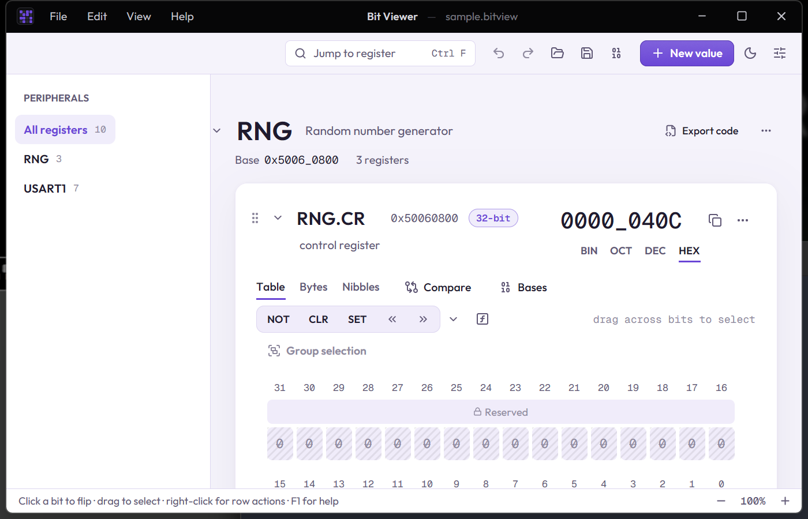

# Bit Viewer

A desktop app for viewing and editing values of 1–512 bits, one bit at a time. Useful for hardware registers, protocol fields and float bit patterns.



> [!WARNING]
> **This project is vibecoded.** The code was written by an AI (Claude, via Claude Code) from the maintainer's prompts, not by hand. The maintainer chose the features, tried the app and reported bugs. Unit and end-to-end tests check its behaviour, and the code has been reviewed line by line by a human skimmingly. Commits made with the AI carry a `Co-Authored-By: Claude` line.

## Features

- **Bits:** click to flip, drag to select, Alt+drag to paint. Full keyboard control.
- **Values:** any width from 1 to 512 bits, typed in BIN / OCT / DEC / HEX, or as an expression (`0x1F << 3 | bit(31)`).
- **Layouts:** one line across the window, or one row per byte or nibble.
- **Register fields:** name a group of bits, then give it a formula and unit, named values and read-only / reserved access (protected bits ask before they change).
- **Operations:** NOT, shifts, rotates, byte swap, bit reverse, AND/OR/XOR. With bits selected, they act on the selection only.
- **Readouts:** unsigned, signed, float16 / bfloat16 / float32 / float64, BCD, Gray code, parity and more.
- **Compare:** compare rows with the differing bits highlighted, plus named snapshots.
- **Templates and export:** built-in templates (IEEE-754, RGB565, IPv4…) or your own. Export fields as C macros, a C struct (split into 32 or 64-bit words), Rust or Python, or write your own export template for any language.
- **CMSIS-SVD import:** load a microcontroller's `.svd` file and add its registers as values, with fields, reset values, access and named values, or save them as templates.
- **Peripherals:** group registers into a block with a base address; each register shows its address, and the block exports as a C struct (with offset checks), C `#define`s or a Rust module.
- **Workspace:** undo/redo, auto-save and crash restore, search (Ctrl+F), command palette (Ctrl+K).
- **Look:** dark, light and high-contrast themes, accent colour, compact mode. Interface sounds are optional and off by default.

Press **F1** in the app for searchable help.

New to it? Read the illustrated [guide](docs/guide/01-bits-and-values.md) (also under Help › Guide in the app). Changes are tracked in the [changelog](CHANGELOG.md).

## Install

Download the latest build from [Releases](https://github.com/kernel-dev/bitviewer/releases/latest):

| Platform | File |
|---|---|
| Windows | `*_x64-setup.exe` (or `.msi`) |
| macOS (Apple Silicon / Intel) | `*_aarch64.dmg` / `*_x64.dmg` |
| Linux | `.AppImage`, `.deb` or `.rpm` |

Installed copies update themselves (except the Linux `.deb` / `.rpm`).

> [!NOTE]
> Builds are not code-signed. Windows SmartScreen may warn on first run ("More info" → "Run anyway"). On macOS, right-click the app → Open the first time; if it says the app is damaged, run `xattr -cr "/Applications/Bit Viewer.app"`.

## Build from source

You need Node.js 20+ and [Rust](https://rustup.rs). On Windows you also need the Microsoft C++ Build Tools. For other systems, see the [Tauri prerequisites](https://v2.tauri.app/start/prerequisites/).

```bash
npm install
npm run tauri dev     # run the app with hot reload
npm run tauri build   # installers in src-tauri/target/release/bundle/
```

<details>
<summary>More scripts</summary>

```bash
npm run dev          # UI only, in the browser at http://localhost:1420
npm test             # unit tests (Vitest)
npm run test:e2e     # end-to-end tests (Playwright, uses installed Microsoft Edge)
npm run check        # types, lint, unit tests, rustfmt, clippy, Rust tests
npm run format       # Biome + rustfmt
```

</details>

<details>
<summary>Publishing a release with auto-updates</summary>

Releases are built by GitHub Actions ([`.github/workflows/release.yml`](.github/workflows/release.yml)) for Windows, macOS and Linux.

1. Once: add the repository secret `TAURI_SIGNING_PRIVATE_KEY` with the contents of `~/.tauri/bitviewer.key`.
2. Bump the version in `package.json`, `src-tauri/Cargo.toml` and `src-tauri/tauri.conf.json`, and commit.
3. Tag and push: `git tag v2.1.0 && git push origin v2.1.0`.

The workflow checks that the tag matches the version and that CHANGELOG.md has a section for it, runs all the tests, builds every platform and publishes the release with `latest.json` for the updater. The release notes (also shown by the in-app updater) are that changelog section. `npm run release` still builds a Windows-only release locally.

Every push to `main` and every pull request runs the same checks and the end-to-end tests ([`.github/workflows/ci.yml`](.github/workflows/ci.yml)).

Keep the signing key private and backed up: without it, installed copies can't verify future updates.

</details>

## Shortcuts

| Action | Keys |
|---|---|
| Add 32 / 64-bit / custom width | Ctrl+1 / Ctrl+2 / Ctrl+3 |
| Undo / redo | Ctrl+Z / Ctrl+Y |
| Group selection into a field / clear selection | Ctrl+G / Esc |
| Find / command palette | Ctrl+F / Ctrl+K |
| New / open / save / save as | Ctrl+N / Ctrl+O / Ctrl+S / Ctrl+Shift+S |
| Zoom | Ctrl+wheel, Ctrl+= / Ctrl+- / Ctrl+0 |
| Toggle theme / settings / help | Ctrl+T / Ctrl+, / F1 |

## Project layout

<details>
<summary>Show</summary>

```
src/
  main.ts         entry point
  core/           logic with no UI: value model, number formats, expressions, code export, SVD import
  app/            window, menus, files, undo, session, settings, search, palette
  card/           one value card: bit cells, toolbar, readouts
  ui/             shared widgets, sounds, styles
  dialogs/        settings, help, field details, export…
tests/
  unit/           unit tests (Vitest): npm test
  e2e/            end-to-end tests (Playwright): npm run test:e2e
  docs/           guide screenshot generator (npm run docs:shots)
docs/guide/       illustrated guide (markdown + screenshots, shown in the app too)
src-tauri/        Rust shell: file access, plugins, config
scripts/          release script and changelog reader
```

</details>

## Credits

Built with [Tauri 2](https://v2.tauri.app), TypeScript and Vite. Icons by [Lucide](https://lucide.dev). Fonts are Inter and JetBrains Mono, bundled so the app works offline.

## License

[MIT](LICENSE)
