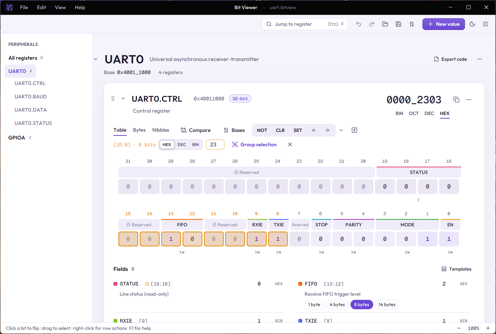

# Bits and values

A **value** is a number from 1 to 512 bits wide, shown as a card. The big number at the top of the card is the whole value; under it, every bit has its own box. Click a bit to flip it, or click the big number and type a new one.

## Reading the bit table

From top to bottom, each row of the table shows:

- **Bit numbers.** Bit 0 is the least significant bit. By default the most significant bit comes first, as in datasheets; **Settings › Bit order in a row** turns that around.
- **Field names**, when the value has [register fields](03-register-fields.md). A coloured line marks where each field starts and ends. Bits outside every field are labelled **Reserved**, with a lock.
- **The bits.** A set bit (1) is highlighted. Striped bits are protected: they are reserved, or belong to a read-only field.
- **Access**, under each field: `rw` for read/write, `r` for read-only.

**New value** in the toolbar adds a value; Ctrl+1, Ctrl+2 and Ctrl+3 add a 32-bit, a 64-bit or a custom-width one. Settings chooses the layout and base new values start with. The width can be changed later with **⋯ › Change width…**.

## Selecting bits

- **Drag** across bits to select them. A selection can cross rows.
- **Click a bit number** to select that one bit, or **drag along the numbers** to select a range without flipping anything. Dragging back to where you started selects one bit again.
- **Shift+click** a bit or a number to extend the selection to it. With nothing selected, Shift+click on a bit selects just that bit (handy for one-bit fields).
- In the **Bytes** and **Nibbles** layouts, click a row's label to select the whole row, then Shift+click another label to extend over several rows.
- **Esc** or the **×** clears the selection.

While bits are selected, the line above the table shows their range and their value. Type into that box to change only those bits, in hex, decimal or binary. **NOT**, **CLR**, **SET**, the shifts and every other [operation](04-operations-and-compare.md) then act on the selection only. **Group selection** (Ctrl+G) turns it into a named field.

## Typing numbers

- The **BIN / OCT / DEC / HEX** tabs under the big number pick its base.
- A prefix overrides the base: `0x`, `0b` or `0o`. Spaces and `_` are ignored, so `0xDEAD_BEEF` works.
- A negative decimal such as `-1` is stored as two's complement.
- Invalid input turns red and the reason appears in a tooltip. **Esc** puts the old value back.
- To type a calculation instead of a number, open the [expression bar](02-expressions.md).

## Keyboard and painting

- Click a bit, or Tab to the bits, to place the cursor. The arrow keys move it, **Space** or **Enter** flips the bit under it, **0** and **1** set it, and **Shift+arrows** select.
- Hold **Alt** and drag to paint bits to 1. **Alt+Shift** and drag paints them to 0. Painting skips protected bits, and one stroke is one undo step.

## Layouts

The tabs above the table choose how the bits are laid out:

- **Table**: rows of 16 bits, like a datasheet register diagram.
- **Bytes**: one row per byte. Each row shows its own value, which you can type into.
- **Nibbles**: one row per 4 bits, which makes reading hex digit by digit easy.

**Bases** shows the whole value in all four bases at once. Each of them can be typed into.

## Readouts

The line at the bottom of the card reads the value in other ways: unsigned, signed, how many bits are set, and as a float. Click a float to type one, such as `1.5`. The **+** at the end adds more readouts: text, BCD, Gray code, parity, leading and trailing zeros, and more.
