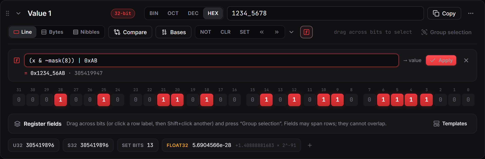

# Expressions

Open the expression bar with the **ƒx** button on a value. Type an expression and watch the result preview update as you type, and as the bits change. Press Enter (or Apply) to write the result into the value, or into the selected bits.

`(x & ~mask(8)) | 0xAB` keeps everything except the low byte and sets that byte to `0xAB`.

## What you can write

| | |
|---|---|
| Numbers | `42`, `0x2A`, `0b101010`, `0o52`, `1_000` |
| Operators | `+ - * / % **`, `<< >>`, `& ^ \|`, unary `- + ~ !`, and parentheses |
| Functions | `min`, `max`, `abs`, `bit(n)`, `mask(n)`, `popcount(x)` |

Precedence follows C: `*` before `+`, shifts after `+`, then `&`, `^`, `|`. `**` is right-associative.

## Names

- `x` (also `this`, `value`, `v`) is the current value.
- The name of one of this value's fields gives that field's value, for example `FCD << 4`.
- The name of another value gives its whole value, for example `Value 2 ^ x`.
- Names with spaces go in braces or backticks: `{Value 2}`.

Fields of other values can't be addressed by name; use the whole value and `(v >> lo) & mask(n)`.

## Good to know

- Math is exact on whole numbers up to 4096 bits. `/` truncates, so `7 / 2` is `3`.
- A result wider than the target is truncated, and the preview tells you so. Negative results are stored as two's complement.
- **Edit › New value from expression** creates a new value from an expression over your other values.
- Field formulas such as `x * 0.5 - 40` use decimal numbers and also know `round floor ceil sqrt pow log log2 log10 exp`, `pi` and `e`.
