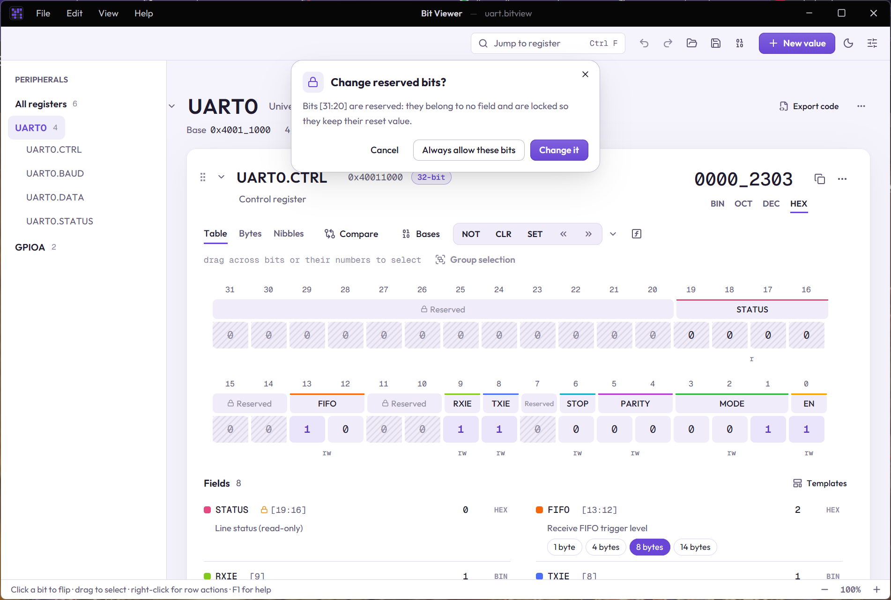

# Register fields

Hardware registers pack several settings into one number. In a UART control register, bit 0 might turn the UART on, bits 3 to 1 pick a mode and bits 13 and 12 set a FIFO level. A **field** gives such a group of bits a name, so you can read and change `MODE` instead of counting bits. Fields can span rows, but they can't overlap.

## Creating a field

Select bits, press **Group selection** (Ctrl+G) and type a name. The field gets a coloured line over its bits and a row in the **Fields** list under the table.

Each row in the list shows the field's name, its bit range (such as `[13:12]`), its value and the base the value is shown in. In a row you can:

- click the name to rename it, or the colour dot to change its colour;
- click the value to type a new one (only that field's bits change);
- click the base (**HEX**, **DEC**, **BIN**) to switch it;
- click a named value, such as **8 bytes**, to set the field to it;
- select the field's bits, open its details, or remove it.

Right-clicking a bit of a field offers the same, and more: rename, colour, select and resize.

[Templates](05-templates-and-workspace.md) add a whole set of fields at once, and an [SVD import](08-importing-svd.md) brings every register's fields from the chip's description.

## Resizing a field

To widen, narrow or move a field:

1. Right-click one of its bits and choose **Select “FIFO”**.
2. Change the selection to the bits you want. For example, Shift+click a bit further along to extend it.
3. Right-click a bit of the field again and choose **Resize “FIFO” to selection**.

The field keeps its name, colour, base and details. If the new range would overlap another field, nothing changes and the message names the field in the way.

## Field details

The sliders button on a field's row opens its **Field details**:

- **Description**: what the field does. The fields list shows up to two lines of it; click it to read all of it.
- **Signed**: read the field as two's complement, so `0xF` in a 4-bit field reads as −1.
- **Formula & unit**: turn the raw number into a real quantity, such as `x * 0.5 - 40` with unit °C for a temperature sensor. The list then shows `25 °C` instead of `130`. Simple straight-line formulas work in both directions: you can type `25` and the field gets the matching raw number.
- **Named values**: names for the numbers, such as 0 = Off, 1 = Asynchronous. They appear as buttons in the list, and in [generated code](06-generating-code.md) as constants.
- **Access**: read/write, read-only or reserved.
- **When written** and **When read**: what the hardware does to the field. A status flag that clears when you write 1 to it is **Write 1 to clear** (`w1c`); one that clears when the register is read is **Reading clears it** (`rc`). These show as chips beside the field, and [SVD imports](08-importing-svd.md) fill them in.

## Protected bits

Some bits shouldn't be changed by accident. A register's datasheet marks them read-only, or reserved: "reserved, keep at reset value". Bit Viewer protects:

- fields whose access is **read-only** or **reserved**, and
- **reserved bits**: the bits of a value that belong to no field. Once a value has fields, the bits between them are labelled Reserved, with a lock.

Protected bits are striped. Anything that would change one asks first: a click, typing a number, an operation, the expression bar, pasting bytes, a named value or restoring a snapshot.

- **Change it** allows this one change. While you type into a box, it allows changes until you leave the box.
- **Always allow these bits** stops asking about them until the app restarts.
- **Cancel** leaves the value as it was.

Alt+drag painting simply skips protected bits.

## Previewing a write

Writing a number to a register isn't always the same as setting it to that number: read-only fields ignore the write, and a **write 1 to clear** flag clears where you write 1 and stays where you write 0. **⋯ › Preview a write…** shows what the register becomes. Type the number you would write, and the dialog lists the result and every field that doesn't simply take what was written, such as `RXNE 1 → 0 (write 1 to clear)`. **Write** sets the value to that result.

## Using fields elsewhere

- In an [expression](02-expressions.md), a field's name stands for its value: `MODE == 1`.
- [Export code](06-generating-code.md) generates C, Rust or Python with each field's position, width and mask.
- [Search](10-finding-your-way.md) finds values by their fields' names and named values.
