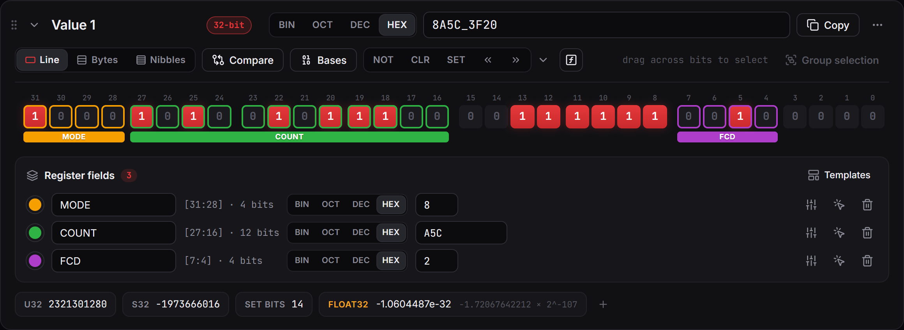
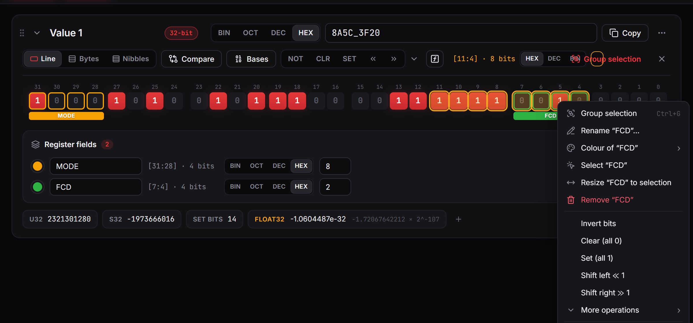

# Register fields

A field is a named group of bits, like `MODE` or `COUNT` in a hardware register. Fields may span rows but can't overlap.

## Creating a field

Select bits, then press **Group selection** (Ctrl+G) and name it. The field appears as a coloured bar under its bits and as a row in the **Register fields** panel, where you can rename it, pick a base, type its value, or delete it.

## Resizing a field

To widen, narrow or move a field:

1. Right-click one of its bits and choose **Select "FCD"**.
2. Change the selection to the bits you want, for example Shift+click to extend it from 4 to 8 bits.
3. Right-click a bit of the field again and choose **Resize "FCD" to selection**.

The field keeps its name, colour, base and details. If the new range would overlap another field, nothing changes and you are told which field is in the way.

## Field details

The sliders button on a field opens its details:

- a description and signed / unsigned,
- a **formula** with a unit, such as `x * 0.5 - 40` °C (linear formulas can be typed back in),
- **named values**, such as 0 = Off and 1 = Auto,
- **access**: read/write, read-only or reserved. Read-only and reserved fields are hatched and ask before their bits change.

## Using fields elsewhere

- In an [expression](02-expressions.md), a field's name is its value.
- **Export code** (the value's ⋯ menu) generates C macros, a C bitfield struct, Rust or Python for the fields.
