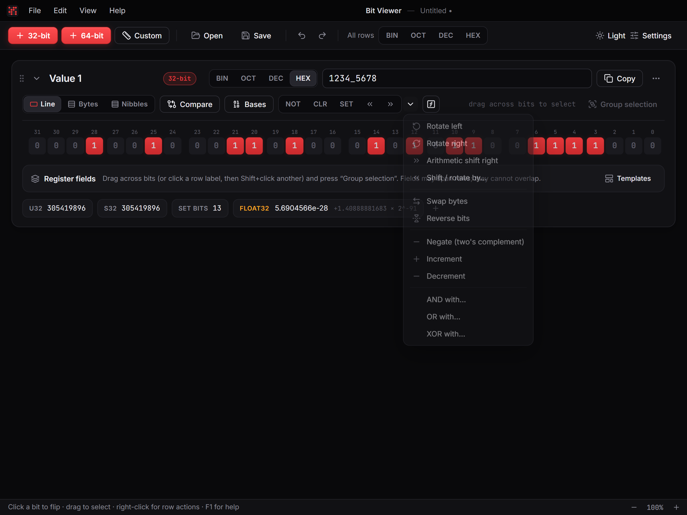

# Operations and compare

## Operations

**NOT**, **CLR**, **SET**, **≪** and **≫** are on every value's toolbar. The ⌄ next to them opens more:

Rotates, arithmetic shifts, shift or rotate by N, swap bytes, reverse bits, negate, increment, decrement, and AND / OR / XOR with a mask (which accepts [expressions](02-expressions.md)). With bits selected, every operation applies to the selection only.

## Compare rows

**Compare** adds a linked row under the value with its own number. Bits that differ are outlined, and the row shows how many bits differ (Δ) and the XOR.

- Edit the compare row like any value, flip its bits, or run operations on it.
- Closing a compare row remembers its value for next time.
- **⋯ › Compare with…** fills compare rows with a value you type: a number, or an expression (`x` is the value itself, so `x ^ 0xFF` works, and other values can be used by name). To take another value as it is, open **Or take the value of another one in the workspace**, filter the list by name and pick it.

## Snapshots

The value's ⋯ menu saves **snapshots**: named copies you can restore, or compare against later.
