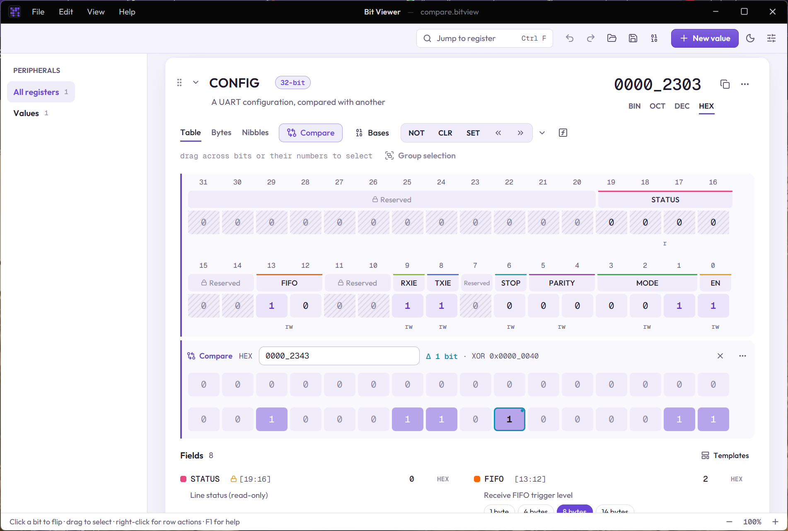

# Operations and compare

## Operations

Every value's toolbar has the common operations:

- **NOT** inverts every bit.
- **CLR** sets every bit to 0, **SET** sets every bit to 1.
- **«** and **»** shift left and right by one bit.

The **⌄** next to them opens the rest: rotate left and right, arithmetic shift right, shift or rotate by any number of bits, swap bytes, reverse bits, negate (two's complement), increment, decrement, and **AND / OR / XOR with…** a mask. The mask can be a number or an [expression](02-expressions.md).

With bits selected, every operation acts on the selection only. Rotating a selected byte, for example, leaves the rest of the value alone. In the Bytes and Nibbles layouts, right-click a row's label for operations on that row.

Operations ask before changing [protected bits](03-register-fields.md).

## Compare rows

**Compare** adds a linked row under the value with a number of its own. It answers "what is different between these two values?": bits that differ are outlined, and the row shows how many bits differ (**Δ**) and the XOR of the two.

- Type a number into the compare row, flip its bits or run operations on it, as with any value.
- Its **⋯** menu can copy it into the value, reset it to the value, or remove it.
- Closing a compare row remembers its number for next time.
- **⋯ › Compare with…** on the value fills the compare row with a number or an expression. In it, `x` is the value itself, so `x ^ 0xFF` works, and other values can be used by name. To compare with another value as it is, open **Or take the value of another one in the workspace**, filter by name and pick it.

## Snapshots

A **snapshot** is a named copy of a value as it is now, kept with the value. Take one from **⋯ › Snapshots › Take snapshot…** before an experiment. The same menu lists them: restore one, compare the value with it, or delete it.
