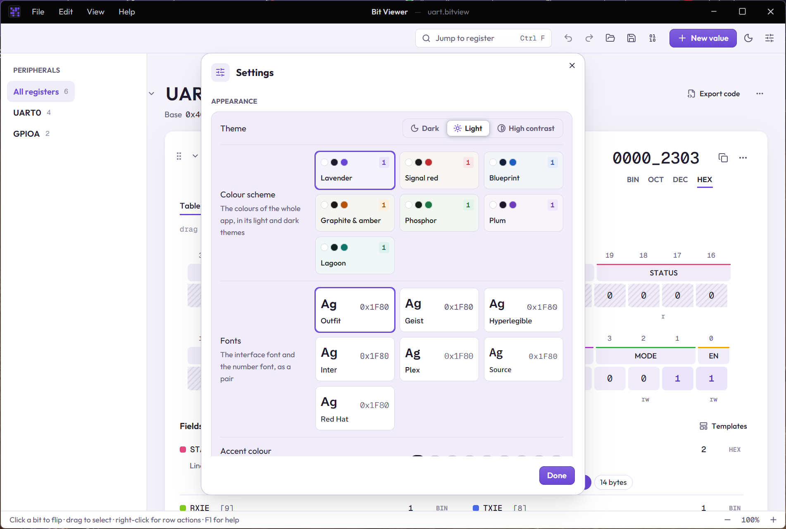

# Templates and workspace

## Templates

A **template** is a set of fields you can put on any value in one go. Open **Templates** in a value's fields list, or use **New value › From a template…**.

The built-in templates are IEEE-754 float32, float64 and float16, bfloat16, RGB565, ARGB8888, IPv4 and the UTF-8 lead byte. To make your own, set up fields on a value and choose **⋯ › Save fields as template…**, or [import them from a CMSIS-SVD file](08-importing-svd.md).

Applying a template to a value that already has fields asks before replacing them. A template wider than the value offers to widen the value.

## Bytes

- **⋯ › Paste bytes…** reads `DE AD BE EF`, `{0xDE, 0xAD}` or `b'\xde\xad'`, in either byte order.
- **⋯ › Copy as bytes** writes hex, a C array or Python bytes, big- or little-endian.

## The workspace

Everything you have open is one **workspace**: its values, fields, peripherals, compare rows and snapshots. It saves as a `.bitview` file.

- **Ctrl+Z** and **Ctrl+Y** undo and redo any change.
- Your work is kept automatically and comes back after a restart or a crash, even if you never saved it.
- **File › Open recent** lists recent workspaces. Drop a `.bitview` file on the window to open it, or a `.svd` file to [import it](08-importing-svd.md).
- Drag a value by its handle (⠿) to move it. The chevron collapses it to its header line.
- **⋯ › Duplicate**, **Move up**, **Move down** and **Remove value** are in every value's menu.

## Settings

**Settings** (Ctrl+, or the sliders button at the top right) has:

- **Theme**: dark, light or high contrast. Ctrl+T switches between light and dark.
- **Colour scheme**: the colours of the whole app, such as Lavender, Signal red or Phosphor, each with a light and a dark version. **Accent colour** changes just the highlight colour.
- **Fonts**: the interface font and the number font, as a pair.
- **Compact mode** and **Zoom** (also Ctrl+= and Ctrl+−).
- **Bit order in a row**, and the layout and base new values start with.
- Which **readouts** are shown, **sounds** and their volume, and checking for updates at start-up.
