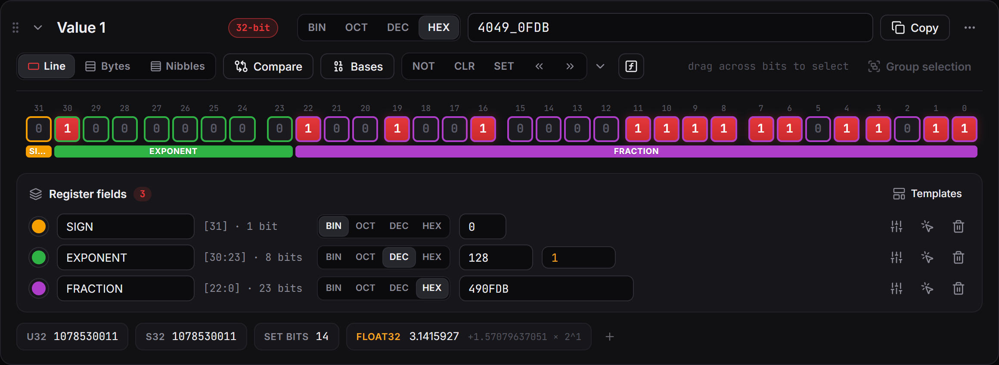

# Templates and workspace

## Templates

A template applies a ready-made set of fields to a value. Open **Templates** in the fields panel, or **Edit › Add value from template**.

Built-in templates: IEEE-754 float32, float64 and float16, bfloat16, RGB565, ARGB8888, IPv4 and the UTF-8 lead byte. To make your own, set up fields on a value and save them from its ⋯ menu, or [import them from a CMSIS-SVD file](08-importing-svd.md).

## Floats, bytes and readouts

- The float chips under a value (float16, bfloat16, float32, float64) are editable: click and type `1.5`.
- **⋯ › Paste bytes** reads `DE AD BE EF`, `{0xDE, 0xAD}` or `b'\xde'` in either byte order. **Copy as bytes** writes hex, C or Python.
- The **+** after the chips adds more readouts such as text, BCD, Gray code, parity and zero counts.

## Workspace

- **Ctrl+Z / Ctrl+Y** undo and redo everything.
- Your work is saved automatically and restored after a restart or crash.
- **File › Open recent** lists recent workspaces. Drop a `.bitview` file on the window to open it (a `.svd` file starts an [SVD import](08-importing-svd.md) instead).
- Drag a value by its handle to reorder it. The chevron collapses it.
- **Ctrl+F** searches values and fields: type, then press Enter (or **Search**). Enter again goes to the next match. **Ctrl+K** opens the command palette.
- **Settings** (Ctrl+,): theme, accent colour, compact mode, zoom, bit order, defaults for new values, sounds and readouts.
