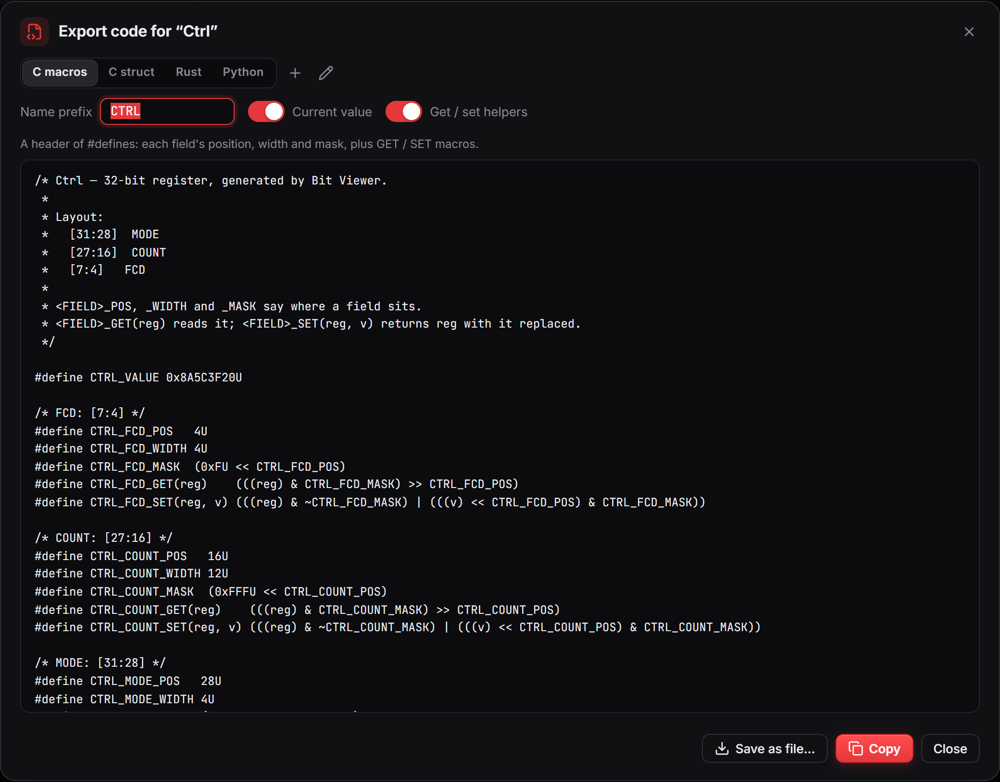
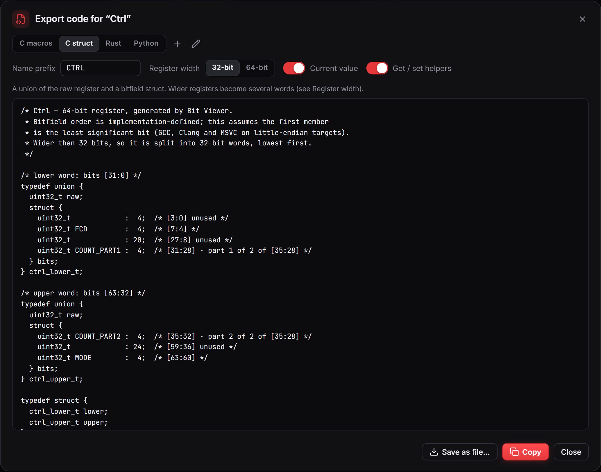

# Generating code

Once a value has [named fields](03-register-fields.md), Bit Viewer can write the source code for them: where each field sits, its mask, and helpers to read or replace it. Paste it into your firmware, driver or script instead of typing bit positions by hand.

## Steps

1. Name your fields. Select bits, press **Group selection** (Ctrl+G) and give each field a name such as `MODE` or `COUNT`. The names become identifiers in the code.
2. Open the value's **⋯** menu and choose **Export code…** (it is also in the command palette, Ctrl+K).
3. Pick a template at the top. A line under the picker says what you get.
4. Adjust the options, check the preview, then click **Copy** or **Save as file…**.

Copy leaves the dialog open, so you can switch template and copy again.

## Built-in templates

| Choice | You get |
|---|---|
| C macros | A header of `#define`s: `_POS`, `_WIDTH` and `_MASK` for each field, plus `_GET(reg)` and `_SET(reg, v)` |
| C struct | A union of the whole register and a struct of bitfields, so `reg.bits.MODE = 2;` works |
| Rust | A module with a shift and mask constant per field and `const fn` getters and setters |
| Python | `_SHIFT` and `_MASK` constants and a getter and setter function per field |

Every file starts with a **Layout** comment listing the fields from the top bit down, with each field's access, formula and description, so the register is documented where it is used.

You are not limited to these. The **+** next to the picker writes a new template for any language or format, and the pencil customises a copy of the one you are looking at. See [Export templates](07-export-templates.md).

## Register width

Templates that use register words, such as C struct, show a **Register width** switch: **32-bit** or **64-bit**. It is the size of a register on your target platform, and it is remembered between sessions.

A value that is wider than that is split into several words, each with its own struct:

- One word: the plain name, for example `ctrl_t`.
- Two words: `ctrl_lower_t` and `ctrl_upper_t`.
- Three or more: `ctrl_1_t`, `ctrl_2_t`, `ctrl_3_t`… counting from the least significant word.
- When there are several words, a final `ctrl_t` struct holds them all as members (`lower`, `upper`, or `word1`, `word2`…).
- The last word uses the smallest integer type that holds its bits, so a 40-bit value on a 32-bit platform ends with a `uint8_t` word.

C bitfields cannot straddle two integers, so a field that crosses a word boundary is split into parts: `COUNT_PART1` at the top of the lower word and `COUNT_PART2` at the bottom of the upper word. A comment on each says "part 1 of 2". Switch to 64-bit and the same field comes out in one piece.

## Options

- **Name prefix** goes in front of every name, for example `CTRL` gives `CTRL_MODE_MASK`. It starts as the value's name (or `REG` if you haven't renamed the value).
- **Current value** adds a constant holding the value that is in the bits right now, handy as a reset value or a test vector. Wide values get one per word.
- **Get / set helpers** turns the read and replace helpers off if you only want positions and masks.

## Things to know

- Named values on a field (0 = Off, 8 = Auto…) become constants such as `CTRL_MODE_AUTO`.
- If two fields would get the same name, the later one gets `_2`, `_3` and so on, so the code always compiles.
- C macros stop at 64-bit integers and Rust at 128. Bigger registers get a comment instead of code for the parts that don't fit. The C struct template has no limit, because it splits into words.
- The C struct assumes the first member is the least significant bit, which is how GCC, Clang and MSVC lay it out on little-endian targets. Use the macros if you need to be portable.
- Fields marked signed or with a formula keep that information in the comments; the helpers always work on the raw bits.
