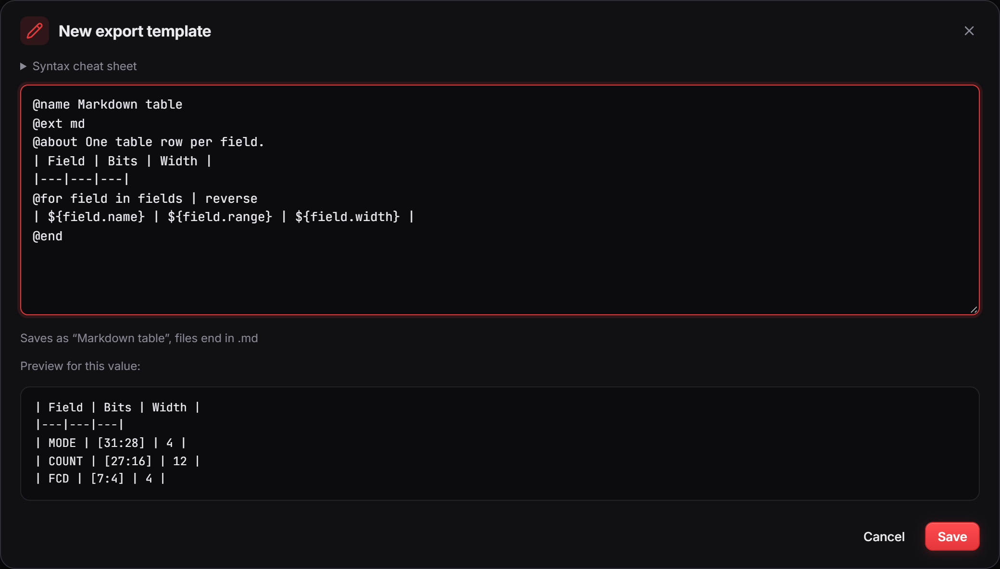

# Export templates

An export template turns a value and its fields into text: source code, a table, a header, anything. Every format in [Export code](06-generating-code.md) is one, including the built-in C, Rust and Python ones, so you can read them as examples.

In the export dialog, **+** starts a new template and the pencil edits the selected one. A built-in template opens as a copy, because built-ins can't be changed. Your templates are saved with your settings.



The preview shows the result for the value you are exporting. A mistake is reported with its line number, and **Save** stays off until it is fixed.

## The idea

A template is the text you want, with two additions:

1. `${...}` is replaced by a value.
2. A line that starts with `@` is an instruction. It is not part of the output.

Everything else is copied as written. This template:

```
@name Markdown table
@ext md
@about One table row per field.
| Field | Bits | Width |
|---|---|---|
@for field in fields | reverse
| ${field.name} | ${field.range} | ${field.width} |
@end
```

produces:

```
| Field | Bits | Width |
|---|---|---|
| MODE | [31:28] | 4 |
| COUNT | [27:16] | 12 |
| FCD | [7:4] | 4 |
```

## Instructions

| Line | Meaning |
|---|---|
| `@name My template` | the label in the picker (required to save) |
| `@ext md` | the file extension for Save as file (default `txt`) |
| `@about Some text` | the description under the picker |
| `@scope peripheral` | a template for a whole [peripheral](09-peripherals.md) instead of one value (the default is `@scope register`); it shows in a peripheral's Export dialog |
| `@# note` | a comment |
| `@for field in fields` … `@end` | repeat the lines in between for each item; `@else` runs when there are none |
| `@if field.signed` … `@elif …` … `@else` … `@end` | choose lines |
| `@set integer_suffix = "ULL"` | remember a value for later lines |
| `@@text` | print a line that starts with `@` |

A line starting with `@` followed by anything that isn't one of these words, like Python's `@property`, is printed as it is. Spaces before the `@` are allowed, so you can indent instructions. Trailing spaces on output lines are removed.

## Values

Inside `${ }` you can write:

- names, with dots to reach inside: `field.range`, `word.storage`
- numbers and `"strings"`, and `true` / `false`
- `+` and `-` (`+` also joins text: `prefix + "_" + field.id`)
- comparisons `==  !=  <  <=  >  >=` and `and`, `or`, `not`, with parentheses
- filters after a `|`: `${field.id | lower}`

| Filter | Does |
|---|---|
| `upper`, `lower` | change case |
| `pad(n)`, `padl(n)` | pad to n characters on the right or left, to line things up |
| `join(", ")` | put a list's items in one line |
| `reverse` | reverse a list, so `@for field in fields \| reverse` goes from the top bit down |
| `default(x)` | use `x` when the value is empty |
| `lead(" — ")` | put the text in front of the value, but only when the value isn't empty: `${field.description | lead(" — ")}` |
| `rust_ident` | make a name safe in Rust: keywords become raw identifiers (`type` → `r#type`; `self` → `self_`) |

Lists have a `.length`. Inside a loop, `loop.index` (from 1), `loop.first`, `loop.last` and `loop.count` are available.

## Numbers

Values, masks and named values are numbers that can be written in four ways:

| Write | For `0x7FFF` in a 16-bit register |
|---|---|
| `${value.hex}` | `0x7FFF` |
| `${value.bin}` | `0b0111111111111111` |
| `${value.dec}` | `32767` |
| `${value.oct}` | `0o77777` |

`${value}` on its own prints the hex form, so templates written before this existed keep working. Hex digits are upper case and not padded. The binary form is padded with zeros to the width of whatever it describes: a register's width for `value`, a field's width for a field's `value` and `mask`, and the register's width for `shifted_mask`. The prefixes `0x`, `0b` and `0o` are always included. Since text is just text, you can drop them with a template of your own, for example `${value.dec}` for plain decimal, or add `U` or `n` after a number for your language.

## What a template can read

**At the top level**

| Name | Is |
|---|---|
| `name` | the value's name (or the prefix) |
| `prefix` | the name prefix from the dialog, as an identifier |
| `width` | the value's width in bits |
| `value` | the current value, a number (see above): prints as `0x8A5C3F20`, also `.bin`, `.dec`, `.oct` |
| `include_value`, `accessors` | the two switches in the dialog |
| `platform` | the register width: 32 or 64 |
| `word_count` | how many words the value is split into |
| `uint_bits` | the smallest of 8, 16, 32, 64, 128 that holds the value, or 0 if none does |
| `name_width`, `range_width` | the longest field name and range, for aligning columns |
| `fields` | the fields, lowest bit first |
| `words` | the register words, lowest first |
| `description` | the value's description |
| `block` | the name of its peripheral, or empty |
| `has_offset`, `offset` | whether it has an offset in its peripheral, and the offset (a number) |
| `has_address`, `address` | whether its address is known (a peripheral with a base address), and the address |
| `address_bits` | 32, or 64 when the address doesn't fit in 32 bits |

**A field** (`field` in `@for field in fields`)

| Name | Is |
|---|---|
| `name` | the name as you typed it |
| `id` | an identifier made from it: `Ctrl reg` becomes `CTRL_REG`, and repeats get `_2`, `_3` |
| `lo`, `hi`, `width` | position and size in bits |
| `range` | `[7:4]`, or `[3]` for one bit |
| `value` | what the field holds right now, a number such as `0xF`, also `.bin`, `.dec`, `.oct` |
| `mask` | the mask of `width` bits, a number such as `0xF` |
| `shifted_mask` | the mask in place, a number such as `0xF0` |
| `access` | `rw`, `ro` or `reserved`; `readonly` and `reserved` are true or false |
| `signed`, `formula`, `unit`, `description` | the field's details |
| `comment` | a one-line description with the range: `[7:4] · read-only` |
| `note` | the same without the range, empty for a plain field |
| `named` | a list of `label`, `id` and `value` (a number) for each named value |
| `crosses` | true if the field spans two words |

**A word** (`word` in `@for word in words`)

| Name | Is |
|---|---|
| `name` | empty for one word, `lower` and `upper` for two, `1`, `2`, `3`… for more |
| `suffix` | `name` with a leading underscore, or empty, for building type names |
| `member` | a name for the word in a combined struct: `lower`, `upper`, `word1`… |
| `title` | `register`, `lower word`, `upper word`, `word 3`… |
| `lo`, `hi`, `width` | the bits it covers and how many |
| `storage` | 8, 16, 32 or 64: the smallest integer type that holds it |
| `value` | the word's part of the value, a number (padded to the word's width in binary) |
| `fields` | the fields in this word |
| `items` | the fields and the unused gaps between them, in order, padded up to `storage` |

An item in `items` has everything a field has, and also:

- `gap` is true for unused bits (its `id` and `name` are empty, and its `comment` says "unused").
- `bit` is the position inside the word.
- For a field split across words, `partial` is true, `part` and `parts` say which piece it is, and `id` becomes `COUNT_PART1`, `COUNT_PART2`. `field_id` is always the whole field's id.

## Peripheral templates

A template with `@scope peripheral` exports a whole peripheral. It reads:

| Name | Is |
|---|---|
| `name`, `prefix`, `description` | the peripheral's name, the name prefix from the dialog, its description |
| `has_base`, `base` | whether it has a base address, and the address (a number) |
| `address_bits` | 32, or 64 when an address doesn't fit in 32 bits |
| `include_value` | the Current value switch |
| `registers` | the registers in offset order (those without an offset last) |
| `layout` | the registers that have an offset, with gaps between them, for structs |
| `unplaced` | the ids of registers without an offset |
| `size` | bytes from the base to the end of the last register |
| `name_width` | the longest `declaration` in `layout`, for aligning columns |

A register in `registers` has everything a single value's template sees (`fields`, `words`, `value`, `address`…), and also:

| Name | Is |
|---|---|
| `id` | an identifier from its name without the peripheral: `UART0.CTRL` becomes `CTRL` |
| `bytes` | its size in bytes |
| `type`, `array` | a C type that holds it, `uint8_t` to `uint64_t`, or `uint32_t` with `array` `[3]` above 64 bits |
| `rust_type` | the same for Rust: `u32`, or `[u32; 3]` |

An item in `layout` is a register with `member` true, a register that starts inside the one before it with `overlap` true, or a gap with `gap` true, `id` `RESERVED0`…, `offset`, `bytes` and `range`. Every item has a `declaration` such as `CTRL`, `DATA[3]` or `RESERVED0[2]`.

```
@scope peripheral
typedef struct {
@for item in layout
@if item.gap
  uint8_t  ${item.declaration};
@elif item.member
  volatile ${item.type} ${item.declaration};
@end
@end
} ${prefix | lower}_t;
```

## A longer example

The built-in C struct template, which shows words, items and padding:

```
@for word in words

@if word_count > 1
/* ${word.title}: bits [${word.hi}:${word.lo}] */
@end
typedef union {
  uint${word.storage}_t raw;
  struct {
@for item in word.items
    uint${word.storage}_t ${item.id | pad(name_width)} : ${item.width | padl(2)};  /* ${item.comment} */
@end
  } bits;
} ${prefix | lower}${word.suffix}_t;
@end
```

For the built-in templates in full, open the export dialog, click the pencil, and read the copy it gives you.
