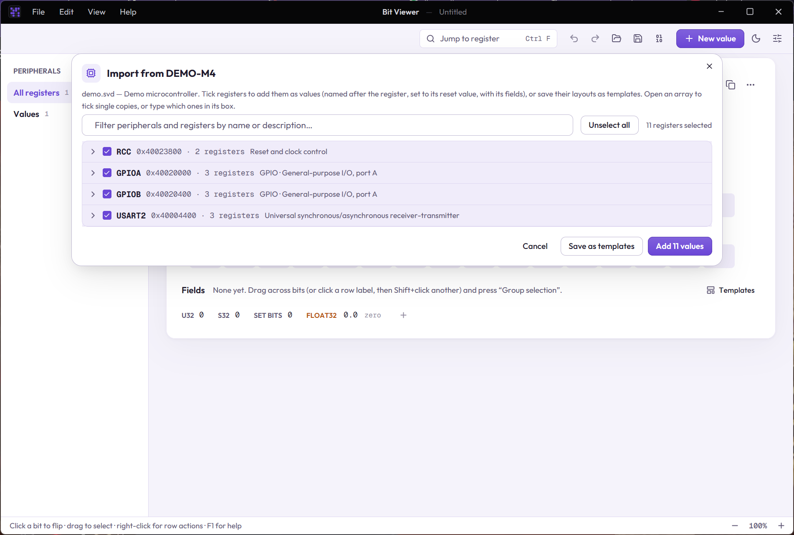

# Importing CMSIS-SVD

Chip vendors describe every register of an Arm Cortex-M microcontroller in a **CMSIS-SVD** file (`.svd`, an XML format): addresses, fields, access and named values. Bit Viewer can read one and turn its registers into values, so you don't have to type the fields in yourself.

## Importing

1. **File › Import CMSIS-SVD…** (or drop a `.svd` file on the window).
2. Pick the registers. Everything starts selected; **Unselect all** / **Select all** toggles every register at once. Tick a peripheral to take all of its registers, or open it with the arrow and tick single registers. The filter matches peripheral and register names and descriptions, and while it is in use the toggle only acts on what it shows (**Select all matching**). A register array (from `dim`) is one row, such as `CCR[0-3]`: tick it to take every copy, open it with its arrow to tick single copies, or type the copies you want in its box, counted from 0 (`0-7, 12`).
3. **Add values** adds each register as a value, or **Save as templates** keeps the layouts for later.

Each added value:

- goes into a [peripheral](09-peripherals.md) block with the peripheral's base address, at the register's offset,
- is named after the register, such as `UART0.CTRL` (usable as a name in [expressions](02-expressions.md)), and gets its description,
- has the register's width and **reset value**,
- has its fields, with their descriptions,
- gets **named values** from the SVD's enumerated values, such as 0 = Off,
- marks read-only fields as read-only, and fields called `RESERVED` as reserved (see [register fields](03-register-fields.md)).

One **Ctrl+Z** removes everything an import added.

## Templates

**Save as templates** stores each register as a field template named after the device and register, such as `DEMO-M4 UART0.CTRL`. Its description holds the address and reset value. Apply one to any value from **Templates** in its fields panel ([templates](05-templates-and-workspace.md)). Saving a register again replaces the older template.

## What is read

| SVD | In Bit Viewer |
|---|---|
| `size`, `access`, `resetValue`, `resetMask` | inherited from the device, peripheral and cluster as the spec says |
| `derivedFrom` | peripherals, clusters, registers, fields and enumerated values copy what they don't override |
| `dim`, `dimIncrement`, `dimIndex` | arrays of any size, also on clusters and peripherals: `CCR[%s]` with dim 4 gives `CCR0` … `CCR3`. Only the copies you pick are made. A `dimIndex` that doesn't fit the dim (such as `A-Z` for 30 copies) is numbered from 0 instead |
| clusters | flattened into the name: `TIM1.CH0.CCR` |
| field bits | `bitOffset` + `bitWidth`, `lsb` + `msb`, or `bitRange` `[7:4]` |
| enumerated values | `#1x0` style values with don't-care bits become one named value per match |

Some files describe the same bits twice (for example alternative meanings of one field). Fields can't overlap in Bit Viewer, so the later one is left out; a ⚠ after a register's field count says so, and hovering shows which. Registers wider than 512 bits are skipped, and a field array keeps only the copies that fit in its register.

The format is described in the [CMSIS-SVD specification](https://open-cmsis-pack.github.io/svd-spec/main/).
