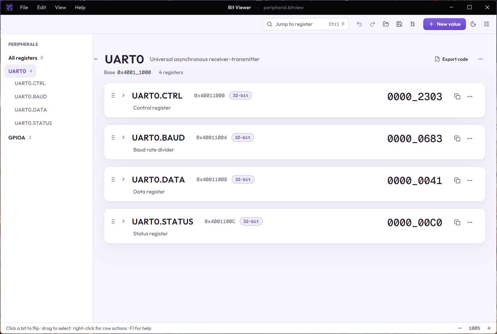

# Peripherals

A **peripheral** is a block of registers at a base address, such as a UART at `0x40011000` with CTRL at offset `0x0`, BAUD at `0x4` and DATA at `0x8`. Bit Viewer can group values into one: the block gets a header, and each register shows its address.

Each peripheral also gets an entry in the sidebar. Click it to show only its registers (see [finding your way](10-finding-your-way.md)).



## Making one

- [Importing from CMSIS-SVD](08-importing-svd.md) puts every register in its peripheral, with the base address and offsets from the file.
- By hand: a value's ⋯ menu › **Peripheral › New peripheral from this value…** asks for a name, an optional base address, a description and the value's offset (all addresses and offsets are hex).
- **Add to peripheral** (in the same submenu) moves a value into an existing peripheral, placed after its last register.
- In the peripheral's ⋯ menu, **Add register** adds a 32-bit register at the next free, 4-byte aligned offset.

## Working with it

- Each register's header shows its **address** (base + offset), or just `+offset` while the peripheral has no base address. Click it to change the offset.
- Click the peripheral's name or base address to rename it or change its base and description. Renaming `UART0` to `UART1` also renames registers called `UART0.…`.
- The chevron collapses the whole peripheral. A search still shows matches inside collapsed peripherals.
- **Export code** on the peripheral's header generates code for all of its registers (below).
- A peripheral's registers stay together: dragging or **Move up / down** reorders them within it, and the peripheral's ⋯ menu moves the whole block. **Sort registers by offset** puts them in address order.
- **Ungroup** keeps the values but forgets the peripheral; **Remove peripheral** deletes it with its registers. Both can be undone.
- A value's ⋯ › **Add description…** notes what it is for. It shows under the name, cut to one line; click it to read all of it. SVD imports fill it in.

## Exporting

The **Export code** button on a peripheral generates code for all of its registers at once:

| Template | Gives you |
|---|---|
| C peripheral struct | a struct with each register at its offset (gaps filled with `RESERVEDn` bytes), `_Static_assert` checks of every offset, `UART0_BASE` and a `UART0` pointer |
| C peripheral addresses | `#define`s for the base address and each register's offset and address |
| Rust peripheral | a module with `BASE`, each register's offset and a raw pointer to it |

```c
typedef struct {
  volatile uint32_t CTRL;          /* 0x0 Control */
  volatile uint16_t BAUD;          /* 0x4 Baud rate divider */
  uint8_t           RESERVED0[2];  /* 0x6–0x7 unused */
  volatile uint8_t  DATA;          /* 0x8 Data */
} uart0_t;

#define UART0_BASE 0x40011000UL
#define UART0 ((uart0_t *)UART0_BASE)
```

Registers that start inside the one before them (two names for the same address) are left out of the struct with a comment. Exporting a single register of a peripheral also gives its address: `#define UART0_CTRL_ADDR 0x40011000U` in C, `ADDR` in Rust and Python.

You can write your own peripheral templates too: see [export templates](07-export-templates.md).
