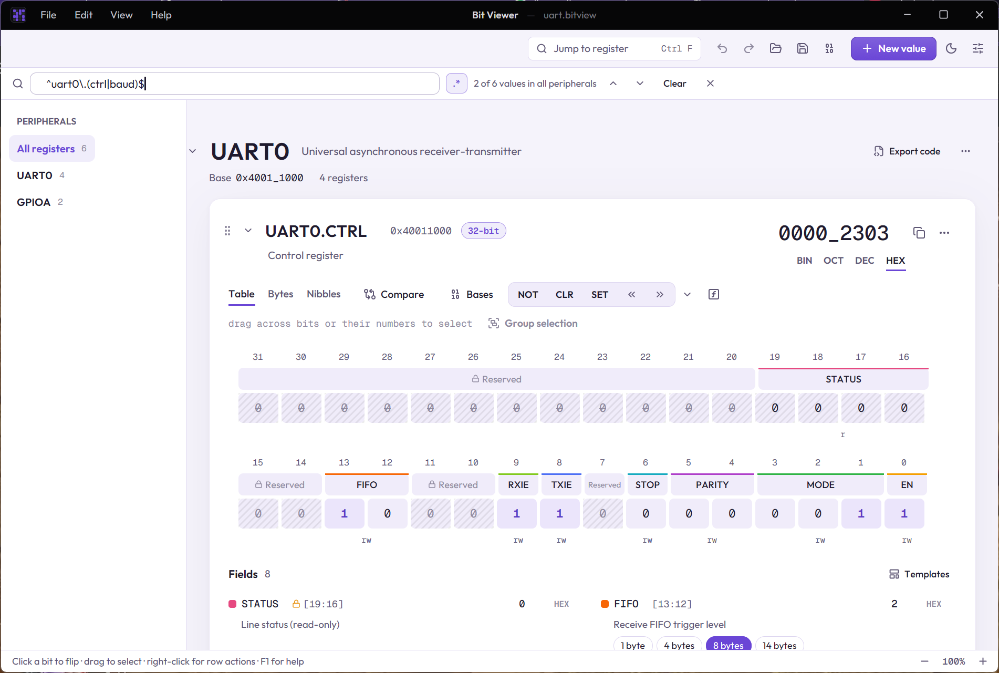

# Finding your way

A workspace from an SVD file can hold thousands of registers. The sidebar, the search bar and the command palette help you get to the right one.

## The sidebar

The sidebar on the left lists the workspace's [peripherals](09-peripherals.md):

- **All registers** shows every value, peripheral after peripheral.
- Click a peripheral to show only its registers. The registers are then listed under it; click one to scroll to it.
- **Values** holds the values that aren't in any peripheral.

The number after each entry is how many registers it has.

## Search

**Ctrl+F**, or the **Jump to register** box at the top, opens the search bar. It searches as you type, through every value in the workspace, not just the open peripheral. It looks at:

- names of values and peripherals, and descriptions,
- field names and named values (search `RXNE` to find the status register that has it),
- snapshot names,
- the value itself, in hex (search `2303`).

- **Enter** goes to the next match, **Shift+Enter** to the previous one. The arrows do the same.
- **Only in** keeps the search to the open peripheral.
- **Esc** hides the bar but keeps the results, so you can work on them. **Ctrl+F** brings the bar back.
- **Clear** throws the results away and shows every value again.

Case never matters.

### Regular expressions

With the `.*` button on (or **Alt+R**), the search text is a regular expression. Some patterns that help with registers:

| Pattern | Finds |
|---|---|
| `^uart0\.` | the registers of UART0 |
| `\.(ctrl\|baud)$` | every register called CTRL or BAUD |
| `^tim[1-4]\.ccr` | the CCR registers of TIM1 to TIM4 |
| `en$` | anything whose name ends in EN, such as fields like TXEN |
| `^gpio[a-c]\.(mode\|od)r$` | MODER and ODR of GPIOA, GPIOB and GPIOC |

A pattern that isn't valid yet shows **Invalid pattern** with the reason, and the last results stay until it is valid.

## The command palette

**Ctrl+K** (or Ctrl+Shift+P) opens the command palette: type part of what you want, such as `export`, `theme` or `64`, and press Enter. Every command in the menus is there, with its shortcut, so it is also a quick way to learn the shortcuts. **F1** lists all controls and shortcuts.
